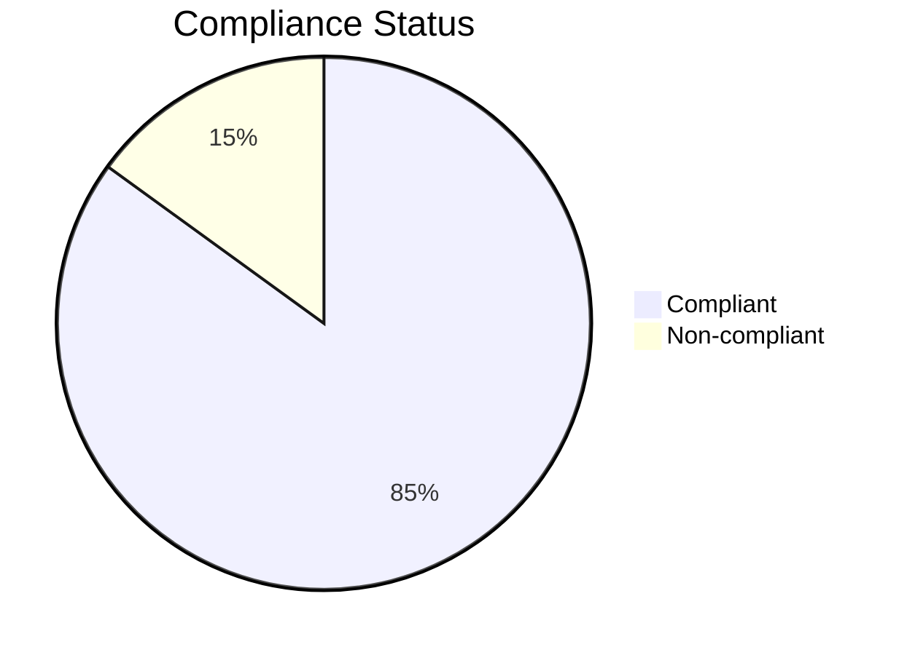

Here is a realistic example of what the `audit_results` dictionary would look like, along with the corresponding **Detailed Markdown** (for the UI) and **Summary Markdown** (for the LLM).

### 1. Example `audit_results` Dictionary

This is the internal Python dictionary generated during execution.

```python
audit_results = {
    "audit_summary": {
        "total_rules_executed": 3,
        "entities_audited": {"cells": 100, "sites": 0},
        "execution_timestamp": "2025-12-01 14:30:00"
    },
    "cell_audits": {
        "carrier_assignment": {
            "summary": "Carrier Assignment: 85/100 cells have PCI assigned",
            "md_data": "### Carrier Assignment\n\n**Purpose**: Analyzes carrier assignment...\n\n#### Summary Statistics...",
            "stats": {"total": 100, "yes": 85, "no": 15},
            "success": True
        },
        "beamforming_support": {
            "summary": "Beamforming: 92/100 cells supported",
            "md_data": "### Beamforming Support\n\n**Purpose**: Find cells with DL/UL beamforming...\n...",
            "stats": {"total": 100, "yes": 92, "no": 8},
            "success": True
        },
        "downtilt_compliance": {
             "summary": "Downtilt Compliance: 45/100 cells compliant",
             "md_data": "### Downtilt Compliance\n\n**Purpose**: Antenna Downtilt Compliance Check...\n...",
             "stats": {"total": 100, "yes": 45, "no": 55},
             "success": True
        }
    },
    "site_audits": {}
}
```

---

### 2. Detailed Markdown (`md_data`)

This is the rich, full report shown to the user in the UI.

```markdown
# Network Infrastructure Audit Report

**Generated at**: 2025-12-01 14:30:00

**Total audit rules executed**: 3

## Table of Contents

1. [Executive Summary](#executive-summary)
2. [Entities Audited](#entities-audited)
3. [Cell Infrastructure Analysis](#cell-infrastructure-analysis)

## Executive Summary

This comprehensive audit report provides a detailed analysis of your network infrastructure. The audit examines compliance with established standards and identifies potential issues.

## Entities Audited

| Entity Type | Count | Description |
|-------------|-------|-------------|
| **Cell** | 100 | Cell entities analyzed |

## Cell Infrastructure Analysis

### Carrier Assignment

**Purpose**: Analyzes carrier assignment (PCI) for cells

#### Summary Statistics

- **Total records analyzed**: 100
- **Compliant records**: 85 (85.0%)
- **Non-compliant records**: 15 (15.0%)
- **Compliance rate**: 85.0%

#### Detailed Data Analysis

**Data Table**:

| cell_eid | iid | pci |
| --- | --- | --- |
| CELL_001 | cell_1 | 123 |
| CELL_002 | cell_2 | N/A |
| ... | ... | ... |
| CELL_100 | cell_100 | 456 |

#### Data Visualization

**Compliance Overview Chart**



---

### Beamforming Support

**Purpose**: Find cells with DL/UL beamforming enabled

#### Summary Statistics

- **Total records analyzed**: 100
- **Compliant records**: 92 (92.0%)
- **Non-compliant records**: 8 (8.0%)
- **Compliance rate**: 92.0%

... (Data Table & Chart) ...

---

### Downtilt Compliance

**Purpose**: Antenna Downtilt Compliance Check

#### Summary Statistics

- **Total records analyzed**: 100
- **Compliant records**: 45 (45.0%)
- **Non-compliant records**: 55 (55.0%)
- **Compliance rate**: 45.0%

... (Data Table & Chart) ...
```

---

### 3. Summary Markdown (`data`)

This is the concise version fed to the LLM so it can "reason" about the results without getting overwhelmed by 1000s of rows of data.

```markdown
# Audit Summary

**Timestamp**: 2025-12-01 14:30:00
**Total Rules**: 3

## Entities Audited
- Cells: 100
- Sites: 0

## Results
- Carrier Assignment: 85/100 cells have PCI assigned
- Beamforming: 92/100 cells supported
- Downtilt Compliance: 45/100 cells compliant
```

### Why this split matters:

1.  **User Experience**: The human gets the **Detailed** report with full tables, charts, and nice formatting.
2.  **LLM Efficiency**: The AI gets the **Summary**. It sees *"Downtilt Compliance: 45/100 cells compliant"* and immediately knows there's a problem it should mention to you, without wasting tokens reading a 100-row table of cell IDs.