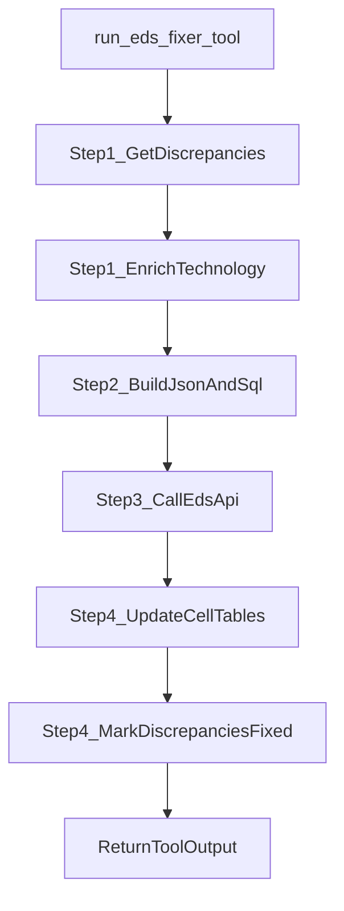
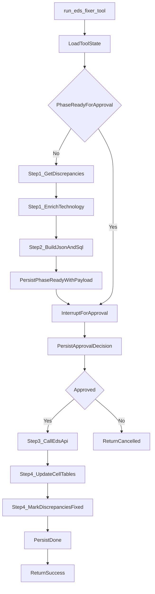

# EDS Fixer Interrupt Design

This document explains:

- how the current `run_eds_fixer_tool` workflow works
- where replay risks exist today
- how to add `langgraph interrupt` inside the tool
- how execution behaves before and after resume

Target implementation file: `agent_server/src/db_agent_v2/tools/eds_fixer/tool.py`

---

## 1) Current Flow (Step-by-Step)

Today, `EDSFixer.execute()` is a linear 4-step write workflow:

1. **Step 1: Fetch discrepancies**
   - Calls `self.discrepancy_engine.run(..., status="mismatch")`
   - Validates result and extracts rows
   - Enriches rows with technology via `_enrich_discrepancies_with_technology()`
2. **Step 2: Build payload and DB actions**
   - `_build_payloads_and_queries(discrepancies, project_name)`
   - Produces:
     - `json_payload` for EDS API
     - `sql_actions` for local DB update (`cell_lte`/`cell_nr`)
3. **Step 3: Call EDS API**
   - `_call_eds_api(json_payload)` sends PUT request
4. **Step 4: Update DB + mark fixed**
   - `_update_postgres(project_name, sql_actions)`
   - `_mark_discrepancies_as_fixed(project_name, sql_actions)`

### Current sequence



---

## 2) Current Control/Safety Behavior

### What already exists

- Clear step-wise errors and `stream_writer` progress updates.
- DB update transaction in `_update_postgres`.
- Cleanup is only attempted after successful DB update.

### What is missing for pause/resume

- No in-tool checkpoint between Step 2 and Step 3.
- No persisted phase state for replay.
- If retried/replayed externally, write steps may run again.

---

## 3) Implemented Change

An **interrupt checkpoint inside the tool** after Step 2 using `ASK_HUMAN_BINARY`:

- Execute Step 1 and Step 2 once (read-only).
- Persist outputs (`json_payload`, `sql_actions`) with phase `ready_for_approval`.
- Call `interrupt({"type": "ASK_HUMAN_BINARY", "content": approval_message})`.
- On resume:
  - if approved: run Step 3 (EDS API) and Step 4/5 (PostgreSQL + mark fixed)
  - if rejected: persist `cancelled`, return no-write ToolOutput

The workflow is now 5 steps (was 4): fetch → build → **approval** → API → DB.

---

## 4) Implemented Runtime Model

Per-invocation durable state object stored in `EDSFixer._invocation_cache` (instance-level dict):

- `phase`: `init | ready_for_approval | approved | done | cancelled`
- `project_name`
- `discrepancy_count`
- `json_payload`
- `sql_actions`
- `created_at` (ISO-8601, used for 30-minute staleness eviction)
- `final_result` (cached `ToolOutput` for done-phase replay)

### Keying strategy (implemented)

Cache key = `SHA-256(args_json)[:16]` where `args_json` is a deterministic JSON encoding of all tool arguments (`project_name`, `network_parameters`, `cell_names`, `site_names`, `all`, `region`, `technology`, `date`).

This ensures:
- Same args on resume → same key → cache hit → skip Step 1/2
- Different args → different key → isolated state
- Entries older than 30 minutes are automatically evicted

### State backend

Instance-level Python dict (`self._invocation_cache`). Survives across interrupt/resume within the same process lifecycle. Naturally cleared on process restart.

---

## 5) Implemented Flow



---

## 6) Replay/Resume Semantics

LangGraph resume behavior re-enters execution from node boundary.  
For a tool node, that means tool code is entered again.

So the tool must be replay-safe:

1. On first run:
   - do Step 1 and Step 2
   - persist `ready_for_approval`
   - interrupt
2. On resume:
   - read state
   - skip Step 1 and Step 2
   - apply approval decision
   - continue with Step 3 and Step 4

Without this state guard, Step 1 and Step 2 would rerun unnecessarily.

---

## 7) Data and Side-Effect Boundaries

### Pre-approval zone (safe to compute)

- discrepancy fetch/filter
- technology enrichment
- payload and SQL plan generation

### Post-approval zone (write side effects)

- EDS API PUT request
- local DB update queries
- discrepancy status updates to `fixed`

Design rule:

- no side effects before approval
- all writes only in `approved` phase and once

---

## 8) Error and Recovery Design

### Pre-approval failures

- Return `status=False` with step-specific error.
- State remains `init` or absent.

### Post-approval API failure

- Return failure for Step 3.
- Keep persisted plan, so user can resume/retry intentionally.

### Post-approval DB partial failure

- Preserve current behavior (partial success report).
- Keep detailed failed query report.

### Crash after completion

- If `phase=done`, return cached terminal summary to avoid duplicate writes.

---

## 9) Optional Enhancements

- Add checksum for `json_payload`/`sql_actions` to detect accidental mutation.
- Add TTL cleanup for old in-progress tool states.
- Add audit event rows: `approval_requested`, `approved`, `rejected`, `completed`.

---

## 10) Before vs After (At a Glance)

| Aspect | Before | After (implemented) |
|---|---|---|
| Human approval boundary | External convention in prompt/docstring | Enforced in runtime via `interrupt({"type":"ASK_HUMAN_BINARY",...})` |
| Resume behavior | No in-tool checkpoint | Resume from persisted `ready_for_approval` phase in instance cache |
| Replay safety | None | Explicit phase machine: init → ready → approved/cancelled → done |
| Side-effect control | Sequential, always immediate | Writes gated behind approval; done-phase returns cached result |
| Operational transparency | 4-step stream_writer logs | 5-step stream_writer logs aligned to phases |
| Pre-call requirement | Agent MUST call `ask_human_tool` first | Not needed — approval is built into the tool |

---

## 11) Actual Pseudocode (matches tool.py)

```python
cache_key = _make_cache_key(args)
cached = _load_invocation_state(cache_key)           # None if absent or stale (>30 min)

# ── Fast-path: already completed ──
if cached and cached.phase == "done":
    return cached.final_result

# ── Phase init: run Step 1/2 and persist ──
if not cached or cached.phase == "init":
    discrepancies = fetch_and_enrich()                # Step 1
    json_payload, sql_actions = build_plan()           # Step 2
    _save_invocation_state(cache_key, {
        phase="ready_for_approval", json_payload, sql_actions, ...
    })
else:
    json_payload, sql_actions = cached.json_payload, cached.sql_actions   # resume path

# ── Step 3: Binary interrupt ──
approval_msg = _build_approval_summary(...)
user_response = interrupt({"type": "ASK_HUMAN_BINARY", "content": approval_msg})
approved = normalize_to_bool(user_response)            # deny-safe default

if not approved:
    _save_invocation_state(cache_key, {phase="cancelled"})
    return cancelled_output()

_save_invocation_state(cache_key, {phase="approved"})

# ── Step 4/5: Writes (only reachable after approval) ──
api_result = _call_eds_api(json_payload)               # Step 4
db_result = _update_postgres(sql_actions)               # Step 5
_mark_discrepancies_as_fixed(sql_actions)

final_result = build_success_output(api_result, db_result)
_save_invocation_state(cache_key, {phase="done", final_result})
return final_result
```

Key properties:
- Step 1/2 run at most once per cache key (skipped on resume via persisted artifacts)
- Writes only execute after explicit approval
- Done phase returns cached result on any subsequent replay
- Cancelled phase prevents writes permanently for that invocation
